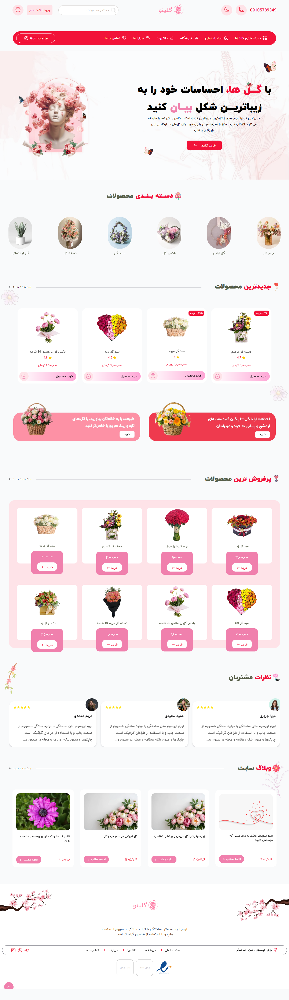
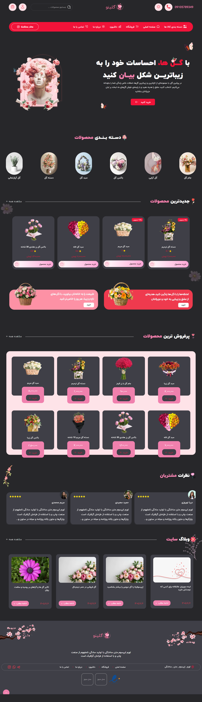
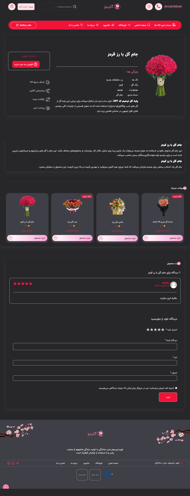
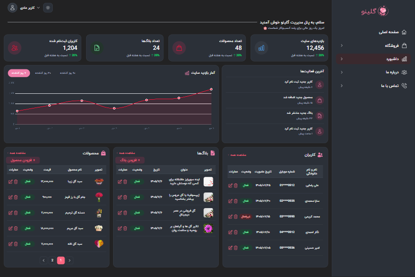
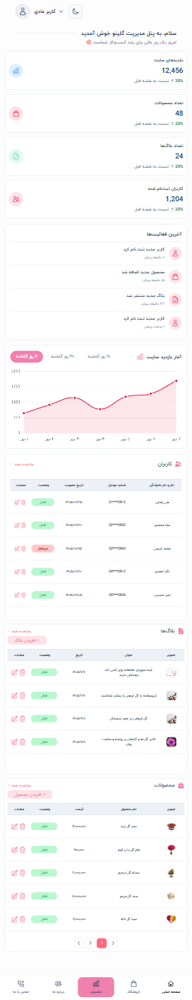

# 🌸 Golino — Flower Shop Website

# Homepage — Desktop




# Product Details page



# Admin Dashboard


A responsive flower shop website built with **HTML5, Tailwind CSS v4, JavaScript, and Supabase**.

Golino is a Persian RTL flower shop project designed to provide a clean and engaging shopping experience. It combines a responsive storefront, interactive shopping cart, dynamic product data, authentication, and an admin dashboard for managing store content.

## 🌐 Demo

- **Live Demo:** Add your deployed website URL here
- **GitHub Repository:** [SinaMohamadi22/golino](https://github.com/SinaMohamadi22/golino)

## ✨ Features

### 🛍️ Storefront

- Responsive, mobile-first design for mobile, tablet, and desktop.
- Persian language support and right-to-left (RTL) layout.
- Dynamic product rendering using Supabase.
- Product details pages.
- Product categories, prices, discounts, stock information, and ratings.
- Interactive product sliders using Swiper.js.
- Responsive navigation and interactive UI components.

### 🛒 Shopping Cart

- Add products to the shopping cart.
- Update product quantities.
- Calculate cart totals dynamically.
- Persist cart data using Local Storage.
- Responsive cart interface for different screen sizes.

### 🔐 Authentication

- User authentication with Supabase Auth.
- Authentication state handling.
- Conditional UI based on the user's authentication status.
- Login and registration entry points for unauthenticated users.

### 🖥️ Admin Dashboard

The project includes an admin dashboard for displaying store data and managing content.

- **Dashboard Overview:** Summary cards and a visit analytics chart.
- **Product Management:** Display products retrieved from Supabase, including their details and status.
- **Blog Management:** Display and manage blog content.
- **User Management:** Display user profile information.
- **Pagination:** Navigate through product, blog, and user lists.
- **Content Forms:** Forms for adding and editing products and blog posts.
- **Image Storage:** Integration with Supabase Storage.
- **Theme Switching:** Light and dark modes.
- **Dynamic Data:** Dashboard lists are populated from database queries rather than relying entirely on hardcoded data.

> **Dashboard note:** Dashboard features that depend on Supabase require a correctly configured backend, appropriate database records, and valid access policies. Administrative actions should be protected by server-side authorization and database policies, not just frontend UI checks.

### 🎨 UI & User Experience

- Mobile-first responsive layout.
- Persian typography using IranYekan and Morabba fonts.
- Interactive modals, dropdowns, and accordions.
- Scroll-based animations using Intersection Observer.
- Theme preferences persisted with Local Storage.
- Consistent visual styling across the storefront and dashboard.

## 🧰 Tech Stack

| Technology | Purpose |
|---|---|
| HTML5 | Page structure |
| Tailwind CSS v4 | Styling and responsive layouts |
| JavaScript (ES Modules) | Application logic and interactivity |
| Supabase | Database and authentication |
| Supabase Storage | Image storage |
| Chart.js | Dashboard charts |
| Swiper.js | Interactive sliders |
| Local Storage | Persisting cart data and UI preferences |
| Git & GitHub | Version control and source code hosting |

## 📁 Project Structure

The project uses separate JavaScript modules to organize application features and keep the code more maintainable.

The following is a high-level overview; refer to the repository for the exact file structure.

```text
Golino/
├── index.html
├── modules/
│   ├── theme.js
│   ├── navigation.js
│   ├── auth.js
│   ├── products.js
│   ├── cart.js
│   └── ...
├── cofig/
│   └── supabase.js
├── public/
│   └── ...
├── dashboard.html
├── product.html
└── README.md
```

**Note:** The example above illustrates the intended organization. Update the filenames and paths to match the actual repository structure if they differ.

## 🚀 Getting Started

### Prerequisites

- [Git](https://git-scm.com/)
- [Visual Studio Code](https://code.visualstudio.com/) or another code editor
- A local development server, such as the VS Code Live Server extension
- A Supabase project for backend-dependent features

### 1. Clone the Repository

```bash
git clone https://github.com/SinaMohamadi22/golino.git
cd golino
```

### 2. Run the Project Locally

Open the project folder in your code editor and serve it using a local development server.

For example, with the VS Code Live Server extension:

1. Open the project folder.
2. Open the main HTML file.
3. Click **Go Live**.

A local server is recommended because the project uses JavaScript ES modules and makes requests to Supabase.

### 3. Configure Supabase

Some features require a Supabase backend.

1. Create a project in [Supabase](https://supabase.com/).
2. Configure the Supabase URL and publishable key in the project's Supabase configuration file.
3. Create the database tables and columns expected by the application.
4. Configure Supabase Storage if you want to use product and blog images.
5. Set up appropriate Row Level Security (RLS) policies and permissions.
6. Add the required records to the database.

The exact schema and access policies must match the queries and operations implemented in the source code.

### 4. Database and Storage

The application uses Supabase to retrieve and manage dynamic data.

The dashboard expects the relevant database tables and fields to exist. For example, the project uses product information, blog content, and user profile data.

If images are stored in Supabase Storage, make sure the bucket configuration and access permissions match the application's upload and image URL logic.

> Never expose a Supabase `service_role` key or other privileged secret in frontend code. Browser-side code should use an appropriate publishable key, with access controlled by Supabase authentication and security policies.

## 🖥️ Exploring the Admin Dashboard

To explore the dashboard:

1. Run the project using a local development server.
2. Open the dashboard page in your browser.
3. Make sure the Supabase configuration is valid.
4. Verify that the database contains the required records.
5. Open the Products and Blogs sections to inspect the dynamically rendered lists.
6. Explore pagination, dashboard charts, theme switching, and the available content forms.

### Troubleshooting

**Product or blog lists are empty**
- Check the Supabase connection.
- Verify table names, column names, and database records.
- Check the relevant RLS policies and query permissions.

**Images are not displayed**
- Verify the stored image path or URL.
- Check the Storage bucket and its access policies.
- Make sure the frontend uses the correct URL format.

**Database operations fail**
- Check the browser console and network requests.
- Verify authentication state and database permissions.
- Inspect the Supabase logs for relevant errors.

**The dashboard cannot be opened directly**
- Make sure the project is served over HTTP rather than opened through the `file://` protocol.
- Check the dashboard HTML and JavaScript module paths.

## 🔒 Security Considerations

Supabase authentication identifies users, but it does not automatically grant permission to perform every database operation.

For a production deployment:

- Enable and configure RLS on tables containing application data.
- Restrict administrative operations to authorized users.
- Protect user profile data from unauthorized access or modification.
- Apply appropriate Storage policies for uploading, reading, and deleting files.
- Never rely on hiding frontend buttons as the only access-control mechanism.
- Never commit privileged credentials or secrets to the repository.

## 📱 Responsive Design

Golino follows a mobile-first approach, with layouts and interactive components adapted for different screen sizes.

The interface is designed to keep the storefront and dashboard usable across mobile, tablet, and desktop devices.

## 📚 What This Project Demonstrates

Golino demonstrates practical frontend development skills, including:

- Building responsive interfaces with Tailwind CSS.
- Writing modular JavaScript using ES modules.
- Managing interactive UI states and browser storage.
- Fetching and rendering dynamic data from Supabase.
- Integrating authentication into a frontend application.
- Building a dashboard with data lists, pagination, forms, and charts.
- Working with image storage and third-party libraries.
- Organizing a multi-page project for maintainability.

## 👨‍💻 Author

**Sina Mohamadi**

Front-End Developer

- GitHub: [@SinaMohamadi22](https://github.com/SinaMohamadi22)

---

*Built with HTML, Tailwind CSS, JavaScript, and Supabase. 🌷*
